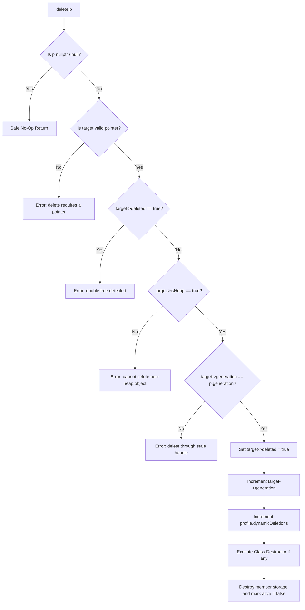

# PRAXIS M3 — Dynamic Storage Management & Heap Semantics

## 1. Overview

Milestone M3 implements dynamic object allocation and explicit deallocation for the Praxis interpreter runtime. The dynamic storage subsystem integrates with Praxis's typed AST, semantic analyzer, and object lifetime manager to provide rigorous C++ dynamic object semantics.

---

## 2. Allocation Architecture (`new`)

Dynamic allocation is initiated via `Expr::Kind::New`, parsed from expressions such as:
- `new T` (default initialization / value initialization)
- `new T(args...)` (direct initialization with constructor overload resolution)

### 2.1 Runtime Allocation Sequence
1. **Quota Check:**  
   `Interpreter::allocate(t, initialized)` verifies `liveObjects < limits.objects`. If exceeded, a diagnostic `live object limit exceeded` is raised without leaking partial allocations.
2. **Metadata Registration:**  
   The allocated `Object` has its metadata assigned:
   - Unique monotonic `id`,
   - Initial generation `generation = 1`,
   - `isHeap = true` (marking dynamic lifetime),
   - `initialized = false`,
   - Global statistics increment: `++profile.dynamicAllocations`.
3. **Construction:**  
   - For scalar types, values are initialized to zero or converted from arguments.
   - For class/struct records, constructor overload resolution selects the matching constructor and executes member initializers in declaration order.
4. **Pointer Handle Creation:**  
   Returns a `Pointer` with `targetId = o->id`, `generation = 1`, `target = o`, and `offset = 0`.

---

## 3. Deallocation Architecture (`delete`)

Deallocation is initiated via `Expr::Kind::Delete`, parsed from `delete ptr`.

### 3.1 Safety Check & Deallocation Sequence

---

## 4. Invariants Enforced

| Invariant | Praxis Implementation Behavior |
|---|---|
| **Null Deletion Safety** | `delete nullptr;` returns immediately without error and does not increment `dynamicDeletions`. |
| **Double-Free Detection** | If a heap object was already destroyed, a subsequent `delete` raises `double free detected`. |
| **Non-Heap Delete Protection** | Deleting an automatic stack object (`int x; delete &x;`) raises `cannot delete non-heap object`. |
| **Destructor Single Execution** | The destructor of dynamically constructed classes executes exactly once at the moment of `delete`. |
| **Quota Enforcement** | Dynamic allocations honor `--max-objects` limits and clean up intermediate resources upon failure. |

---

## 5. Verification Evidence

- **Unit Checks:** `tests/unit/m3.cpp` (Checks 5–10, 27–28).
- **Integration Tests:** `tests/m3/cases.json` (`dynamic_scalar`, `dynamic_class`, `delete_null`, `dynamic_loop`, `raii_raw_wrapper`, `raii_linked_list`).
- **Adversarial Tests:** `err_double_free`, `err_delete_stack`, `err_use_after_free`.
- **MSVC Differential Testing:** Full behavioral parity across all dynamic storage fixtures.
