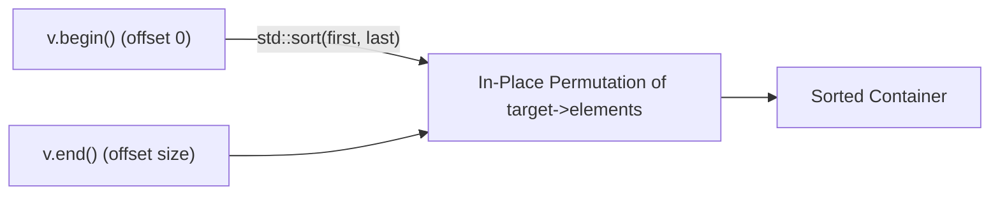

# PRAXIS M3 — Iterator Semantics & Range-Based For Architecture

## 1. Abstract Iterator Representation

In Praxis, iterators for sequential containers (`std::vector<T>`, `std::array<T, N>`) are modeled directly as **validated pointer handles**:

```cpp
Pointer p;
p.isNull = false;
p.targetId = container->id;
p.generation = container->generation;
p.target = container;
p.offset = 0; // or container->elements.size() for end()
```

This model provides:
1. **Random-Access Iterator Capabilities:**  
   Because iterators are pointer handles, expressions such as `it++`, `it--`, `it + n`, `it - n`, `it1 < it2`, and `it2 - it1` work natively via Praxis's pointer binary operator engine.
2. **Bounds and Expiration Safety:**  
   Dereferencing an iterator (`*it`) checks whether the underlying container is still alive and ensures `0 <= offset < container->elements.size()`. Dereferencing past-the-end iterators (`v.end()`) is caught with `pointer offset out of bounds`.

---

## 2. Standard Algorithm Integration

Because iterators behave as random-access pointer handles, algorithms in `<algorithm>` operate directly on iterator intervals `[first, last)`:



- `std::sort(first, last)`: Sorts elements using host std::sort on the slice `[first.offset, last.offset)`.
- `std::reverse(first, last)`: Reverses elements in place.
- `std::find(first, last, val)`: Linearly scans elements and returns a `Pointer` with the found offset, or `last` if not found.
- `std::count(first, last, val)`: Counts occurrences in the interval.

---

## 3. Range-Based For Loop Semantics

Praxis supports range-based for loops across all sequential containers:
```cpp
for (declaration : range-expression)
    statement
```

### 3.1 Execution Pipeline
1. **Range Evaluation:**  
   The range expression is evaluated once. The resulting object is inspected for container type (`vector`, `array`, or `string`).
2. **Iteration Protocol:**  
   For each element `i` from `0` to `elements.size() - 1`:
   - A nested lexical scope is opened.
   - If the loop variable is a reference (`T&` or `const auto&`), it binds as an alias to the container element:
     ```cpp
     iterScope->names[name] = container->elements[i];
     ```
   - If the loop variable is by value:
     - For records/classes: `copyObject` performs deep copy.
     - For scalars: A new storage cell is allocated and value-initialized.
   - The loop body statement executes.
   - Scope cleanup destroys any loop-body locals.
   - Flow control (`break`, `continue`, `return`) is respected.

### 3.2 String Range Iteration
When the range is `std::string`, Praxis extracts character bytes and binds `char` variables for each position, enabling standard string character inspection.

---

## 4. Verification Coverage

- `tests/unit/m3.cpp`:
  - Check 20: `std::sort` on vector iterators
  - Check 21: `std::reverse` on vector iterators
  - Check 22: `std::find` and `std::count`
  - Check 23: `for (int x : v)` over vector
  - Check 24: `for (auto x : v)` with auto deduction
  - Check 25: `for (char c : s)` over string
- Integration suite:
  - `vector_iterator_loop`, `algo_sort`, `algo_reverse`, `algo_find`, `algo_count`, `range_for_vector_int`, `range_for_vector_auto`, `range_for_string`, `accumulator`.
- MSVC Differential: 100% agreement on all iterator and range-for cases.
