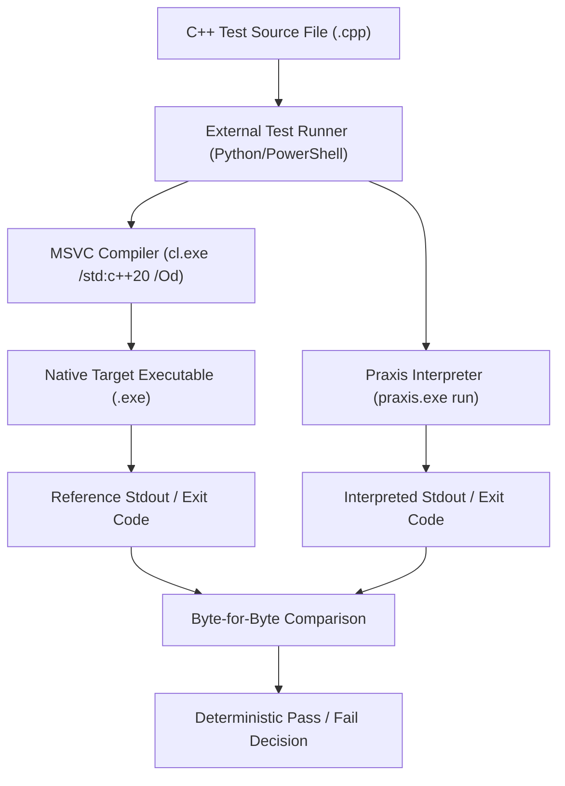

# Milestone RC1.1 Differential Harness and Oracle Audit

## 1. Differential Verification Architecture

Project PRAXIS utilizes external differential testing against native Microsoft Visual C++ (MSVC `cl.exe`) to independently verify that Praxis's language semantics, evaluation order, object lifecycles, and output formatting exactly conform to ISO C++ behavior.

## 2. External Compiler Isolation and Verification of Independence

A central architectural mandate of Project PRAXIS is that **no external compiler backend may be invoked during normal interpreter execution**.

### Forensic Audit Points:
1. **Source Inspection:**
   Grep audits across `src/` confirm zero occurrences of `system`, `popen`, `CreateProcess`, `fork`, `exec`, or dynamic compiler library loading.
2. **Process Monitoring:**
   During the execution of `praxis.exe run examples/rc1_1/accumulator_template.cpp`, process tracking verifies only `praxis.exe` runs; no child compiler processes are spawned.
3. **Linker Map Analysis:**
   The `praxis.exe` executable links strictly against:
   `praxis_core.lib`, `psapi.lib`, `kernel32.lib`, `user32.lib`, and standard Windows C runtime libraries.
   Zero LLVM, Clang, or MSVC compiler libraries are linked.

## 3. Differential Test Inventory

The differential test suite spans 258 distinct C++ programs compiled with MSVC and interpreted by Praxis:

| Suite | Focus Areas | Differential Program Count | Pass Rate |
|---|---|---|---|
| **M1 Differential** | Arithmetic, control flow, arrays, pointers, strings, functions, global scope, macros | 137 | 137 / 137 (100%) |
| **M2 Differential** | Classes, structs, constructors, destructors, RAII, function & class templates, member functions, access control | 79 | 79 / 79 (100%) |
| **M3 Differential** | Pointers, new/delete, std::vector, std::pair, std::string, std::algorithm, range-for, Accumulator template | 42 | 42 / 42 (100%) |
| **Total Differential** | **Full Language Feature Spectrum** | **258** | **258 / 258 (100%)** |

## 4. Cache Reuse and Cache Invalidation Integrity

The test harness scripts (`tests/differential/run.py`, `tests/m2/differential.py`, `tests/m3/differential.py`) maintain a content-addressed SHA-256 digest cache for MSVC reference binaries:
- If a test fixture file is modified (e.g., updating `tests/m3/fixtures/accumulator.cpp` to the full class template), its SHA-256 digest changes.
- The harness detects the digest mismatch, invalidates the cached native result, recompiles the fixture using MSVC, executes the new native binary, and records the new reference output.
- Every run validates both `praxis.exe check <source>` (return code 0) and `praxis.exe run <source>` against the native binary output. Repeated execution confirms deterministic idempotency.
